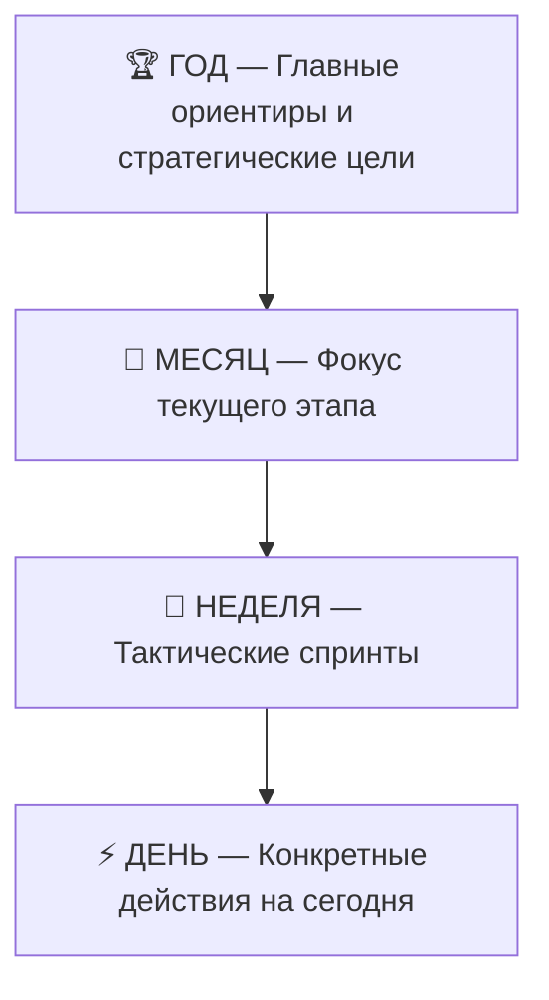

# 🧭 Руководство по планеру личной эффективности и дисциплины

Добро пожаловать в систему персональной эффективности! Этот планер создан не для того, чтобы заваливать тебя бесконечными списками задач, а чтобы **держать баланс в ключевых сферах жизни, не выгорать и системно двигаться к большим целям**.

---

## ⚡ Главная философия: 4 сферы жизни

Вся система построена вокруг баланса 4 фундаментальных направлений:
1. **💪 Тренировки (Спорт и тело)** — физическая форма, здоровье, энергия, сон и восстановление.
2. **💼 Дело (Бизнес и карьера)** — проекты, заработок, ключевые задачи, профессиональный рост.
3. **📚 Учёба (Интеллект и навыки)** — книги, курсы, иностранные языки, изучение нового.
4. **🧘 Личность (Характер и баланс)** — ментальное здоровье, порядок, чтение, окружение, отдых.

Когда все 4 сферы получают регулярное внимание, пропадает ощущение «одно развиваю, а остальное рушится».

---

## 📱 Экран 1: «Сегодня: Фокус» (Ежедневный ритм)

Это твой рабочий стол на каждый день. Утром ты заходишь сюда, чтобы увидеть ясную картину дня.

### 1. Верхняя панель метрик
- **🔋 Заряд дня (0–100%)**: показывает общий прогресс дня. Складывается из выполненных привычек (60% веса) и закрытых задач из плана (40% веса). При достижении 100% срабатывает праздничный салют!
- **🎯 Индекс дисциплины**: средний процент закрытия твоего плана за неделю.
- **🔥 Суммарные серии (Smart Streak)**: сумма непрерывных дней выполнения всех твоих привычек.

### 2. Утренний и вечерний ритуал (Рутины)
- Блоки **«Утренняя рутина»** и **«Вечерняя рутина»** помогают правильно начать и спокойно завершить день (например: стакан воды, зарядка, планирование, чтение перед сном).

### 3. Фокус дня: ключевые задачи
- Здесь отображаются задачи, запланированные именно на сегодня.
- **Умный перенос задач**: если день пошёл не по плану, любую задачу можно в один клик перенести:
  - Кнопка **«Завтра ➔»** — мгновенно переносит задачу на следующий день.
  - Иконка **«Календарь»** — позволяет выбрать любую будущую дату.
- **Инбокс (Быстрые входящие)**: блок для мгновенной фиксации мыслей и внезапных идей, чтобы они не отвлекали прямо сейчас. Позже их можно в один клик превратить в задачу на день.

### 4. Привычки дня
- Список твоих активных привычек с чекбоксами. При нажатии звучит приятный тактильный клик.
- Каждая привычка привязана к одной из 4 сфер.

---

## 🗺️ Экран 2: «Планирование & Горизонты»

Здесь рождается стратегия. Система использует метод **каскадного планирования**: от больших горизонтов к сегодняшнему дню.

### 1. Каскад ключевых целей («Путеводная звезда» ⭐)
- На любом горизонте (Год, Месяц, Неделя) ты можешь нажать на **звёздочку ⭐**, чтобы сделать цель **Главной (Key Goal)**.
- Когда ты переходишь на более детальный уровень (например, планируешь месяц), вверху каждой сферы будет мягко подсвечиваться плашка: *«Путеводная звезда года: Выйти на доход X»*. Ты всегда помнишь, ради чего делаются малые шаги.

### 2. Режим глубокого фокуса на одной сфере (Single Sphere Focus)
- Вверху экрана планирования есть переключатель:
  `[Все 4 сферы] [Тренировки] [Дело] [Учёба] [Личность]`
- Если тебе нужно спланировать проект по работе или спортивный тренировочный план, нажми на нужную сферу:
  - Лишние сферы скроются, не создавая визуального шума.
  - Экран разделится на 2 удобные колонки: **«Стратегия и цели»** (слева) и **«Действия и задачи»** (справа).
  - Сфера сохраняется при переключении между Годом, Месяцем, Неделей и Днём.

### 3. Интерактивный прогресс целей
- У каждой цели есть шкала **0–100%**.
- Можно в один клик корректировать прогресс кнопками `-10%`, `+10%`, `+25%` или завершить цель кнопкой `100%`.

---

## 📊 Экран 3: «Матрица & Аналитика»

Инструмент ретроспективы и честного взгляда на свою неделю.

### 1. Таблица недели (Пн — Вс)
- Наглядная сетка по всем дням недели: сразу видно, какие дни были продуктивными, а где был провал.
- Можно переключать недели назад и вперёд, чтобы отслеживать динамику.

### 2. Умный учёт отдыха (Smart Streak)
- Не все привычки нужно делать каждый день (например, силовые тренировки нужны 3–4 раза в неделю, а не 7/7).
- В планере можно задать квоту: например, **3 дня в неделю (3/7)** или конкретные дни (Пн, Ср, Пт).
- **Важная фишка**: в запланированные дни отдыха твой стрик (серия) **НЕ сгорает**! Система понимает, что отдых — это часть плана.

---

## 🔒 Приватность и сохранность данных

1. **Полная изоляция и приватность**:
   - Приложение работает по принципу **Offline-First**.
   - Все твои привычки, цели, записи и прогресс хранятся **исключительно в твоём браузере (`localStorage`)**.
   - Никакие посторонние люди (включая автора планера) не имеют доступа к твоим данным.
2. **Резервные копии (кнопка «Бэкап» в шапке)**:
   - В любой момент можно нажать **«Экспорт в файл»** и скачать резервную копию со всеми данными в формате `.json`.
   - Если сменил браузер или ноутбук — просто нажми **«Импорт»** и загрузи файл.
3. **Бесплатная синхронизация между телефоном и ПК (Облако Supabase)**:
   - В планер встроен модуль облачной синхронизации.
   - Можно подключить собственную бесплатную базу Supabase (инструкция есть прямо в окне «Облако») и синхронизировать данные между телефоном и компьютером по секретному кодовому слову.

---

## 📲 Как установить на смартфон как приложение (PWA)

Планер работает как полноценное приложение без установки из App Store / Google Play:

### На iPhone (Safari):
1. Открой ссылку на планер в браузере **Safari**.
2. Нажми кнопку **«Поделиться»** (квадрат со стрелочкой вверх внизу экрана).
3. Пролистай вниз и выбери **«На экран «Домой»» (Add to Home Screen)**.
4. Нажми «Добавить». Иконка появится на рабочем столе телефона и будет открываться на весь экран без адресной строки браузера.

### На Android (Chrome):
1. Открой ссылку на планер в браузере **Chrome**.
2. Нажми три точки в правом верхнем углу.
3. Выбери **«Установить приложение»** или **«Добавить на главный экран»**.
